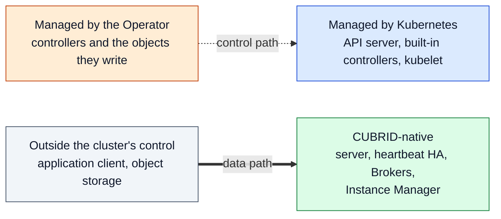

# Architecture in diagrams

> [!IMPORTANT]
> This project is experimental and not production-ready. These pages explain
> how the code on `main` is put together and what has been observed in
> recorded test runs. They add no availability, failover or recovery
> guarantee. [ROADMAP.md](../../ROADMAP.md) is the source of truth for what is
> implemented and what has been validated.

These pages are the diagram-first entry point to the Operator's runtime
architecture. They are written for a reader who knows Kubernetes basics
(Pods, StatefulSets, Services, controllers) but has not read the Go source or
the ADRs. Each page has its diagrams, a paragraph on what they show, the order
in which to read them, their limits, and links to the code, the decision records
and the validation evidence behind it.

## Reading path

Read the pages in this order. Each one reuses the components and the legend
defined below, so a box with the same name is the same thing on every page.

1. **Overview** — this page: the legend, the shared components and short
   answers to the common questions.
2. **[System topology](topology.md)** — what runs where: the Operator's
   Pod, the database members, the Brokers and the Services, for a
   standalone and a three-member HA cluster.
3. **[Reconciliation](reconciliation.md)** — what starts a reconcile, what
   the cluster controller does in what order, when it runs again, and how
   the backup controller drives a backup.
4. **[Client and data path](data-path.md)** — how an application's SQL
   reaches the database, and why that path does not go through the Operator.
5. **[Failure and recovery responsibilities](failure-recovery.md)** — what
   Kubernetes, CUBRID native HA and the Operator each do when the master's
   Pod is lost, and which parts are planned rather than implemented.
6. **[Voluntary disruption](voluntary-disruption.md)** — what a node drain
   may take, for each topology, and what a PodDisruptionBudget cannot protect.
7. **Details** — the [ADRs](../adr/), [DESIGN.md](../../DESIGN.md),
   [docs/observability.md](../observability.md), the
   [scenario contract](../testing/scenario-contract.md) and
   [ROADMAP.md](../../ROADMAP.md) hold the full decisions and evidence. These
   pages link to them instead of copying them.

## Legend

Every diagram uses the same colors for who is responsible for a component.
In the flowcharts, each box has its owner's color, and the line style of an
arrow says what kind of traffic it carries. In the sequence diagrams, the
background behind each group of participants has the owner's color, and the
arrows show the order of the steps in time rather than a kind of traffic.

The two arrows above are only examples of the line styles; the table below
says what each color and line means.

| Style | Meaning |
|---|---|
| Blue box | Kubernetes-managed: the API server and the built-in controllers and kubelet that act on the objects the Operator writes |
| Orange box | Operator-managed: the Operator's manager Pod, its two controllers, and the resources they create and own |
| Green box | CUBRID-native: behavior that belongs to the CUBRID engine and its tools, including the Instance Manager that runs them inside each member |
| Gray box | Outside the cluster's control: the application client and object storage |
| Dotted arrow | Control path: Kubernetes API reads and writes, watches, and the Operator's HTTP calls to an Instance Manager |
| Thick arrow | Data path: SQL from clients, Broker-to-server connections, CUBRID replication, and backup and seeding data moved to and from object storage |

The Instance Manager is drawn green although the Operator project builds it:
it runs inside the database container and only drives local CUBRID
commands, so it sits on the CUBRID side of the boundary. The objects the
Operator creates (StatefulSet, Services, ConfigMaps, Secret) are orange; the
work Kubernetes then does with them, such as starting Pods and keeping
volumes, is blue. Broker Pods are drawn green: the Operator creates their
Deployments, but which server a Broker connects to is CUBRID's own routing.

Each page also labels its statements with one of three evidence levels, as
the [scenario contract](../testing/scenario-contract.md#how-a-statement-is-marked)
and [CONTRIBUTING.md](../../CONTRIBUTING.md#testing-expectations) separate them:

| Label | Means |
|---|---|
| **Design** | Decided in an ADR or DESIGN.md; not necessarily in the code yet |
| **Implemented** | Present in the code on `main`, checked by reading it and by unit or envtest tests; not by itself proof of behavior on a real cluster |
| **Observed** | Seen in a recorded scenario run, with the level named: Kind in CI, or the VM lab. One run on one environment is not a general guarantee |

## Canonical runtime topology

The [system topology](topology.md#data-path) is the canonical **three-member
HA layout** for all these diagrams. The [data-path SQL view](data-path.md#sql-path)
uses the same service names, Pod/Deployment names, number of Pods and
edges; a management or failure sequence can show a *subset*, but must not
invent a different deployment or routing architecture.

| Invariant | Same on every page |
|---|---|
| Application-to-SQL path | Client → `demo-rw` (TCP 33000) or `demo-ro` (TCP 33001) → matching Broker Pods → CUBRID member server (TCP 1523) |
| Broker workloads | `demo-broker-rw` = 2 RW Broker Pods; `demo-broker-ro` = 2 RO Broker Pods; **separate from** the database StatefulSet |
| HA members | StatefulSet `demo`, members `demo-0`, `demo-1`, `demo-2`, one member PVC each; CUBRID heartbeat UDP 59901 and replication between native members |
| Role ownership | **CUBRID Native HA** elects/changes Master. The Operator observes roles, never pins a permanent master to any ordinal or rewrites a Service to target a master Pod |
| Operator control | An Operator manager Pod with two reconcilers, outside the SQL path, writes Kubernetes objects through the API and contacts each member's Instance Manager over authenticated HTTP TCP 9090 |
| Node placement and disruption | Member spreading and PodDisruptionBudgets are Kubernetes placement/eviction controls; they do not elect a Master or provide failover fencing |
| Standalone exception | Same two application Services and Broker Deployments, but **only `demo-0`**; no HA heartbeat, replication peers or three-member StatefulSet |

The labels `demo-0`/`demo-1`/`demo-2` are **member identities, not
primary/replica roles**. A failure-sequence diagram may annotate, for example,
“`demo-0`: Master *before this fault*”, but must explicitly state that the
example does not fix the winner for other faults or runs. Likewise, a
read-only Broker has an RO access mode, **not** a hardwired “slave Service”.
The canonical graph expresses the HA peer group without a permanent
master-to-slave arrow, since that direction changes when CUBRID changes roles.

## Shared components

All pages use these names. The examples use a cluster named `demo` in one
namespace; the real names are built from the `CubridCluster` name.

| Component | What it is | Responsible | Source |
|---|---|---|---|
| Kubernetes API server | Stores every object; all controllers read and write through it | Kubernetes | — |
| `CubridCluster` resource | The desired cluster: standalone (1 member) or HA (3 promotable members) | user writes spec, Operator writes status | [`api/v1alpha1/cubridcluster_types.go`](../../api/v1alpha1/cubridcluster_types.go), [ADR-0001](../adr/0001-ha-topology.md) |
| `CubridBackup` resource | One requested backup of a cluster | user writes spec, Operator writes status | [`api/v1alpha1/`](../../api/v1alpha1/), [ADR-0007](../adr/0007-backup-execution.md) |
| Operator manager Pod | One controller-runtime manager process with leader election, a metrics endpoint and health probes. It is not a database Pod and holds no data | Operator | the `ctrl.NewManager` options in [`cmd/main.go`](../../cmd/main.go), [`config/manager/manager.yaml`](../../config/manager/manager.yaml) |
| Cluster controller | `CubridClusterReconciler`: everything about a `CubridCluster` | Operator | [`internal/controller/cubridcluster_controller.go`](../../internal/controller/cubridcluster_controller.go) |
| Backup controller | `CubridBackupReconciler`: drives one `CubridBackup` to `Completed` or `Failed` | Operator | [`internal/controller/cubridbackup_controller.go`](../../internal/controller/cubridbackup_controller.go) |
| Database StatefulSet `demo` | Pods `demo-0` … `demo-2`, each with its own data volume claim `data-demo-N` | object: Operator; Pods and volumes: Kubernetes | `reconcileStatefulSet` in [`cubridcluster_controller.go`](../../internal/controller/cubridcluster_controller.go) |
| Database member Pod | One database container, `cubrid`, in which the Instance Manager runs as the main process and supervises the CUBRID server and, for HA, heartbeat | Kubernetes runs it; CUBRID runs inside | `podSpec` in `cubridcluster_controller.go`, [ADR-0003](../adr/0003-instance-manager.md) |
| Instance Manager | HTTP API on port 9090 inside each member that runs local CUBRID commands (role, HA bootstrap, backup, restore, shutdown) | CUBRID side (built by this project) | `Server.Handler` in [`internal/instancemanager/server.go`](../../internal/instancemanager/server.go) |
| Headless Service `demo-instances` and member alias Services `demo-0` … | Stable DNS names for each member, which CUBRID HA and the Operator use | Operator | `reconcileHeadlessService` in `cubridcluster_controller.go`, `reconcileMemberServices` in [`memberservice.go`](../../internal/controller/memberservice.go), [ADR-0004](../adr/0004-ha-hostname-dns.md) |
| Broker Deployments `demo-broker-rw`, `demo-broker-ro` | Two read-write and two read-only CUBRID Broker Pods, separate from the database Pods | object: Operator; routing: CUBRID | `brokerReplicas` and `reconcileBrokerTier` in [`broker.go`](../../internal/controller/broker.go), [ADR-0002](../adr/0002-broker-routing.md) |
| Services `demo-rw`, `demo-ro` | Application endpoints (ports 33000 and 33001) that select Broker Pods, never database Pods | Operator | `rwServiceName`, `roServiceName` and `reconcileBrokerService` in `broker.go` |
| NetworkPolicies `demo-database`, `demo-broker` | Ingress rules for the database and Broker Pods | Operator writes them; the network plugin enforces them | `reconcileNetworkPolicies` in [`networkpolicy.go`](../../internal/controller/networkpolicy.go), [Network access](../operations/network-access.md) |
| Object storage | Where backups go and where HA members are seeded from | outside | [ADR-0007](../adr/0007-backup-execution.md) |

## Short answers

**Where does the Operator run?** In its own manager Pod, as one process that
hosts two controllers, with leader election so only one replica acts at a
time (the `ctrl.NewManager` options and the two `SetupWithManager` calls in
`cmd/main.go`; the `--leader-elect` flag is set in
`config/manager/manager.yaml`). It never runs inside a database Pod.
See [System topology](topology.md).

**What triggers reconciliation?** A change to a `CubridCluster`'s spec,
annotations or deletion, a change to any object it owns, and timed requeues:
every 10 seconds for an HA cluster, because a CUBRID failover changes no
Kubernetes object, and shorter or longer delays on specific paths. It is not
a fixed one-second poll. See [Reconciliation](reconciliation.md).

**What does the Operator manage, and what do Kubernetes and CUBRID HA
manage?** The Operator writes the StatefulSet, Services, Broker Deployments,
ConfigMaps, the Instance Manager token Secret and NetworkPolicies, calls the
Instance Manager for HA bootstrap, backup and restore, and reports what it
observes in status and Conditions. Kubernetes starts, restarts and
reschedules Pods and keeps their volumes. CUBRID native HA elects the master,
fails over and replicates; the Operator never chooses or promotes a master
([ADR-0005](../adr/0005-failover-split-brain.md), "Responsibility split").

**How do clients reach the database?** Through `demo-rw` or `demo-ro` to a
Broker Pod, which connects to a CUBRID server. The read-write Brokers find the
current master themselves. No SQL passes through the Operator. See
[Client and data path](data-path.md).

**What happens when a database Pod fails?** The StatefulSet controller
recreates the Pod with the same name and volume; if it was the master, CUBRID
heartbeat promotes a slave and the read-write Brokers reconnect to it; the
Operator observes the new roles and updates status. Fencing the old side and
closing the write endpoint while the primary is ambiguous are designed but
not enforced today. See [Failure and recovery responsibilities](failure-recovery.md).

## Two controllers and the six named roles in DESIGN.md

[DESIGN.md §7](../../DESIGN.md#7-high-level-architecture) lists six
reconcilers (cluster, HA, service, storage, backup, update). Those are
responsibilities, not separate controllers. In the code they are two
controllers registered with one manager:

| DESIGN.md §7 role | Where it is in the code |
|---|---|
| Cluster Reconciler | `CubridClusterReconciler.Reconcile` in [`cubridcluster_controller.go`](../../internal/controller/cubridcluster_controller.go) |
| HA Reconciler | the same controller: `reconcileHAConfig` ([`haconfig.go`](../../internal/controller/haconfig.go)), `reconcileHABootstrap` ([`habootstrap.go`](../../internal/controller/habootstrap.go)), `reconcileHAStatus` and `resolvePrimary` ([`haresolve.go`](../../internal/controller/haresolve.go)) |
| Service Reconciler | the same controller: `reconcileHeadlessService`, `reconcileMemberServices`, and the Broker tier in `broker.go` |
| Storage Reconciler | the same controller: the StatefulSet's data volume claim template (`dataPVCTemplate` in `cubridcluster_controller.go`); Kubernetes creates and keeps the volumes |
| Backup Reconciler | `CubridBackupReconciler`, a second controller (`cubridbackup_controller.go`); restore into a new cluster runs in the cluster controller (`reconcileRecovery` in [`bootstrap.go`](../../internal/controller/bootstrap.go)) |
| Update Reconciler | the same controller: `reconcileUpdateGuard` and `reconcileRollingUpdate` (both in [`update.go`](../../internal/controller/update.go)) |

This matches DESIGN.md's requirement that these concerns form one lifecycle
reconciled together rather than independent subsystems.

## Keeping the diagrams current

- [Topology](topology.md) defines one **canonical** set of physical and SQL
  connections. The [SQL-path page](data-path.md) deliberately repeats that
  layout for context; when the topology changes, update both projections in
  the **same PR**. Other sequence diagrams focus on actions but must reuse
  those runtime identities and ownership boundaries. GitHub renders Mermaid
  natively, with no separate generated images to maintain.
- Use the canonical identity table above, these four owner colors and the
  dotted-control/thick-data line convention for every diagram. Mermaid
  sequence participant groups use the same owner colors. Scenario codes and
  issue numbers belong in prose/evidence tables, not boxes. Do not draw a
  fixed `demo-0` Master or place the Operator in the client SQL path.
- When a change moves a behavior from planned to implemented, or adds
  scenario evidence, update the affected page in the same pull request and
  check it against [ROADMAP.md](../../ROADMAP.md).
- To check that the diagrams parse before pushing, render them locally with
  the Mermaid command-line tool, for example
  `npx -y @mermaid-js/mermaid-cli@11.4.2 -i docs/architecture/topology.md -o /tmp/topology.md`,
  which renders every Mermaid block in the file and fails on a syntax error.

## Related work

- How this Operator differs from the official CUBRID Operator is tracked in
  [#627](https://github.com/cubrid-lab/cubrid-kubernetes-operator/issues/627);
  these pages describe only this project.
- Verified installation and recovery procedures are tracked in
  [#125](https://github.com/cubrid-lab/cubrid-kubernetes-operator/issues/125);
  these pages are not runbooks.
