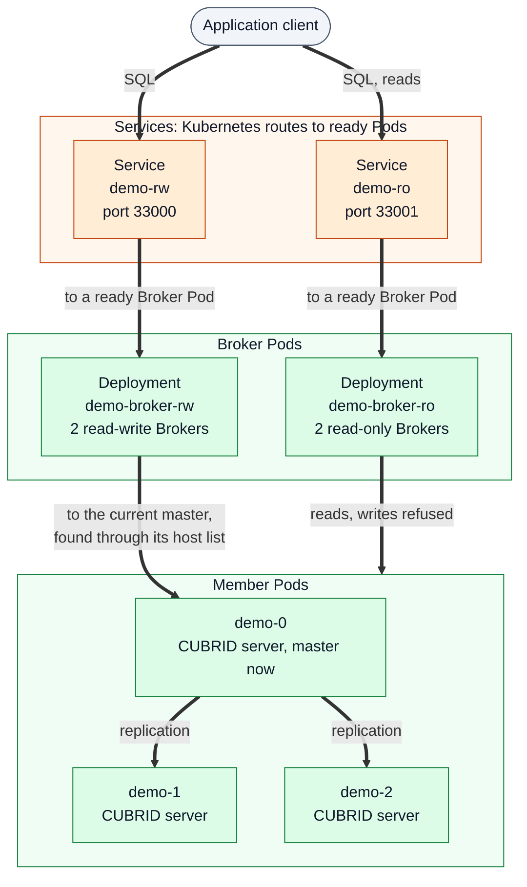
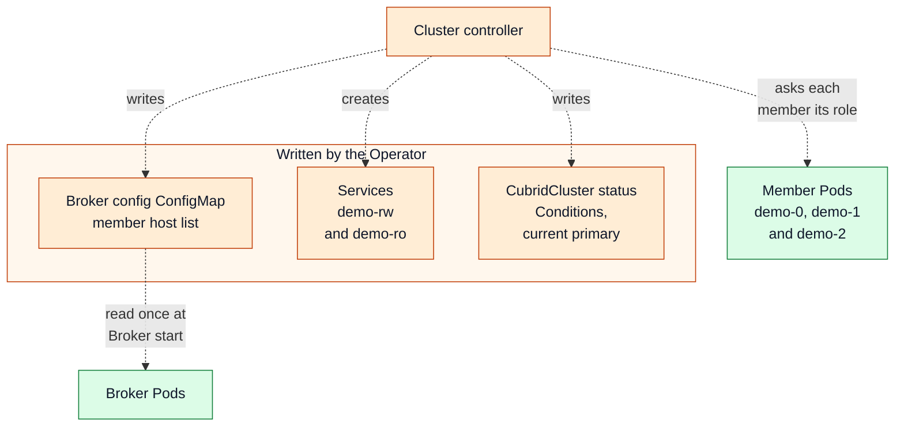

# Client and data path

[Overview](README.md) → [Topology](topology.md) →
[Reconciliation](reconciliation.md) → **Client and data path** →
[Failure and recovery](failure-recovery.md)

> The project is experimental and not production-ready. Colors, line styles
> and evidence labels are explained in the [legend](README.md#legend).

## What it shows

How an application's SQL reaches a CUBRID server in a three-member HA cluster
named `demo`, and who decides each hop. The SQL path (thick arrows) goes from
the client to a Kubernetes Service, to a Broker Pod and to a CUBRID server;
replication runs between the servers. The Operator's management path (dotted
arrows) only writes the objects and configuration that the data path uses. No
SQL passes through the Operator, and the Operator does not switch the
read-write endpoint between database Pods when the master changes.

The SQL path and the management path are drawn as two diagrams with the
same names.

### SQL path

### Management path

The diagram draws `demo-0` as the master at this moment. Which member is
master is decided by CUBRID at run time and can change; after a failover the
read-write Brokers reach the new master through the same host list, and the
Services do not change.

## Key components

- **Services `demo-rw` and `demo-ro`** — Kubernetes Services that select
  Broker Pods by their access-mode label. Kubernetes sends a new connection to
  a ready Broker Pod; a Broker Pod is ready when its port accepts connections.
- **Read-write Brokers** — CUBRID Brokers with `ACCESS_MODE=RW`. Their
  `databases.txt` lists every member
  (`demo-0.demo-instances.<namespace>.svc:...`), and the Broker itself finds
  the member that is master.
- **Read-only Brokers** — CUBRID Brokers with `ACCESS_MODE=RO` and the same
  host list. They serve reads and refuse writes and DDL themselves.
- **CUBRID servers and replication** — the master applies writes; CUBRID HA
  copies and applies its log on the slaves.
- **Management path** — the cluster controller writes the Broker
  configuration and Services, observes roles and publishes status. A Broker
  reads its configuration only when its container starts; a changed
  configuration replaces that mode's Broker Pods one at a time.

## Reading order

1. **Client to Service.** The application connects to `demo-rw` for reads
   and writes or `demo-ro` for reads. It never connects to a database Pod.
2. **Service to Broker.** Kubernetes picks a ready Broker Pod of that access
   mode. Only Broker readiness matters here; the Service does not follow
   `status.currentPrimary`.
3. **Broker to server.** A read-write Broker tries the hosts in its list and
   uses the one that is master. A read-only Broker uses a member from the same
   list and refuses writes.
4. **Server to server.** Replication from the master to the slaves is CUBRID
   HA's own traffic.
5. **Management path, separately.** The controller's dotted arrows only
   prepare the configuration and report status. Nothing on the SQL path waits
   for a reconcile.

## Who decides each hop

| Hop | Decided by | Notes |
|---|---|---|
| Client → `demo-rw` / `demo-ro` | the application | choice of endpoint |
| Service → Broker Pod | Kubernetes (EndpointSlices follow Pod readiness) | the Operator sets the selector and the readiness check, not the choice per connection |
| Read-write Broker → master | CUBRID Broker, from the host list | the Operator generates the list; it does not pick the master |
| Read-only Broker → member | CUBRID Broker, from the host list | which member serves a read has not been pinned down; ADR-0002 leaves the exact read-only target selection to the POC |
| Master → slaves | CUBRID HA | replication; the Operator only reports it (`ReplicationHealthy`) |

## Evidence

| Statement | Level | Where |
|---|---|---|
| `-rw` and `-ro` select Broker Pods, never database Pods; two Brokers per access mode | Implemented, Design | `brokerReplicas`, `reconcileBrokerTier` and `reconcileBrokerService` in [`broker.go`](../../internal/controller/broker.go); [ADR-0002](../adr/0002-broker-routing.md) "Decision" and "As implemented" |
| Brokers run `ACCESS_MODE=RW` or `RO`, and `databases.txt` lists every member's DNS name | Implemented | `memberDNSNames`, `generateBrokerConf`, `writeBrokerSection` and `generateBrokerDatabasesTxt` in [`broker_config.go`](../../internal/controller/broker_config.go) |
| The Operator does not switch `-rw` between database Pods after a failover | Design, Implemented | ADR-0002 "Decision"; no `role=master` selector in `broker.go` |
| A client commits through `-rw`, reads through `-ro`, and is refused a write through `-ro` with `-581` | Observed (Kind in CI) | [ROADMAP.md](../../ROADMAP.md#implementation-and-validation-inventory), rows "Foundation" (standalone) and "HA and Broker"; [scenario contract](../testing/scenario-contract.md), "S01: three-member HA with read-write and read-only access" |
| Writes and schema changes replicate to every member | Observed (Kind in CI) | ROADMAP.md row "HA and Broker"; scenario contract "S02: normal replication" |
| Losing one or all read-write Broker Pods, or the Broker process, recovers without a master change | Observed (Kind in CI) | ROADMAP.md row "HA and Broker"; scenario contract "S05: Broker failure" |
| Broker and routing Conditions | Implemented | [docs/observability.md — Conditions](../observability.md#conditions) |

## Limits and assumptions

- In-flight transactions can fail while a Broker reconnects after a
  failover; applications must retry (ADR-0002, "Failover write sequence").
- Whether a driver's alternate-host settings behave the same behind one
  Service as with several Broker hosts is an open item of ADR-0002 ("Client
  caveat").
- The `BrokerReady`, `WriteEndpointReady`, `ReadEndpointReady` and
  `RoutingReady` Conditions report Broker availability; they do not prove a
  client can run SQL ([README — Client endpoints](../../README.md#client-endpoints)).
- `RoutingReady=False` does not close the write path today; see
  [Failure and recovery](failure-recovery.md#planned-and-partial-behavior).
- Traffic is not encrypted, and the database is created with an empty DBA
  password in `v1alpha1`
  ([README — Network access](../../README.md#network-access)).
