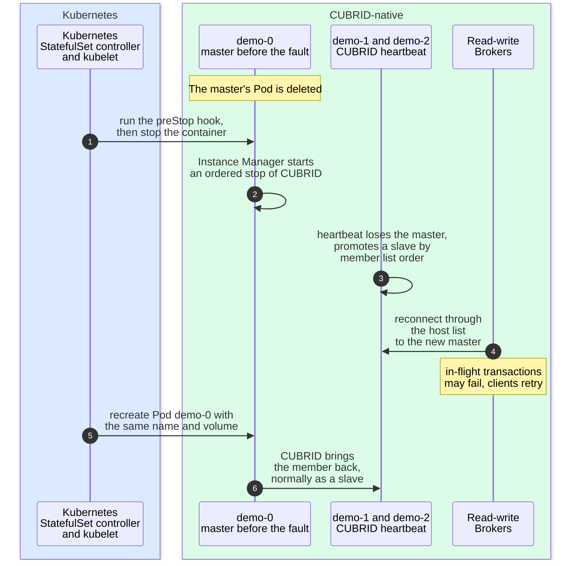
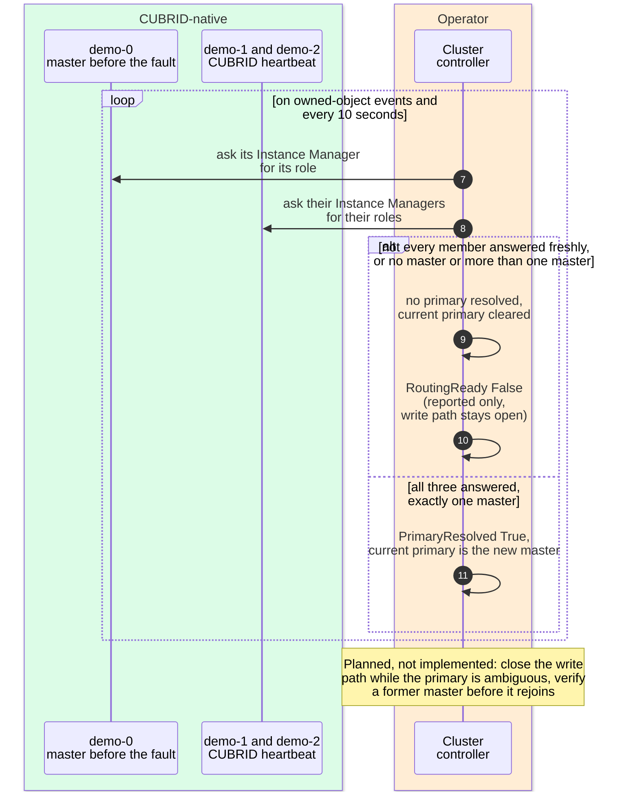

# Failure and recovery responsibilities

[Overview](README.md) → [Topology](topology.md) →
[Reconciliation](reconciliation.md) → [Client and data path](data-path.md) →
**Failure and recovery**

> The project is experimental and not production-ready. Nothing on this page
> is a recovery guarantee. Colors, line styles and evidence labels are
> explained in the [legend](README.md#legend).

## What it shows

One representative failure: the Pod of the current master in a three-member
HA cluster named `demo` is deleted while clients write through `demo-rw`. The
diagram shows which part each of the three actors plays. Kubernetes recreates
the Pod with its volume. CUBRID native HA promotes a slave and the read-write
Brokers follow it. The Operator observes the new roles and reports them; it
does not promote, fence or fail back. The steps marked as planned are design
decisions that the code does not carry out yet.

The sequence is drawn in two parts; participants that appear in both keep
the same names, and the numbering continues. The first part shows what
Kubernetes and CUBRID do, the second what the Operator observes. The
background of each group of participants uses the
[legend](README.md#legend) colors.

### Part 1: the fault, CUBRID failover and the Pod's return

### Part 2: what the Operator observes

## Key components

- **Kubernetes** — the StatefulSet controller recreates the Pod under the
  same name, and the kubelet attaches the same volume. Kubernetes knows
  nothing about CUBRID roles.
- **CUBRID heartbeat** — detects the lost master and promotes a slave in the
  order of the HA member list. This is CUBRID's own failover.
- **Read-write Brokers** — reconnect through their host list to whichever
  member is master. No Service or selector changes.
- **Cluster controller** — keeps asking each member for its role, resolves a
  primary only from fresh answers of all members, and publishes
  `PrimaryResolved`, `HAReady`, `RoutingReady` and `status.currentPrimary`.

## Reading order

1. **Steps 1–2:** the Pod is deleted. The preStop hook asks the local
   Instance Manager to stop CUBRID in order. With a grace period that stop
   can finish. Without one, the Pod object disappears at once, and on the
   pinned Kind the old container was killed about three seconds later, so the
   stop may not finish (scenario contract, S03 "Fault confirmed by").
2. **Step 3:** CUBRID heartbeat on the remaining members promotes a slave.
   The Operator takes no part in this.
3. **Step 4:** the read-write Brokers find the new master through the
   same host list. Open transactions can fail; new ones succeed once the new
   master accepts writes.
4. **Steps 5–6:** the StatefulSet controller creates the Pod again with the
   same name and volume, and CUBRID brings the member back, normally as a
   slave. One exception was observed: when the first member of the member
   list is deleted without a grace period and is back within a second,
   CUBRID can make it master again and promote no slave (POC-19).
5. **Steps 7 onward (part 2), the loop:** on each pass the controller asks
   every member. While any member cannot be observed freshly, or none or two
   report themselves master, no primary is resolved and `RoutingReady` is
   `False`. Once all three answer with exactly one master, `PrimaryResolved`
   becomes `True` and `currentPrimary` names it.
6. **Final note:** two Operator safety steps from the design are not in the
   code yet; see the next section.

## Who does what

| Responsibility | Kubernetes | CUBRID native HA | Operator |
|---|---|---|---|
| Restart or recreate the Pod, keep the volume | yes | — | creates the StatefulSet only |
| Stop CUBRID in order when a Pod is deleted | runs the preStop hook, then stops the container | the Instance Manager drives the stop | defines the hook in the Pod template |
| Detect the lost master and promote a slave | — | yes | never; it does not choose, promote or demote |
| Send writes to the new master | — | Brokers follow the host list | generated the host list in advance |
| Bring the returning member back as a slave | — | yes | **planned:** verify a former master before it rejoins |
| Report roles, primary and routing state | — | — | yes: `PrimaryResolved`, `HAReady`, `RoutingReady`, `currentPrimary`, Events, metrics |
| Close the write endpoint while the primary is ambiguous | — | — | **planned:** today only reported |
| Fence a suspected stale master | — | heartbeat-level split-brain avoidance | never automatically in `v1alpha1`; manual intervention |
| Fail back to the former master | — | — | never automatically |

The responsibility split is decided in
[ADR-0005](../adr/0005-failover-split-brain.md) section 1, "Responsibility
split", and section 6, "Hard NEVER rules".

## Planned and partial behavior

These are design decisions, not current behavior. Do not read the diagram as
if they were in place.

- **Write quarantine is reported, not enforced.** When the primary cannot be
  resolved, the Operator sets `RoutingReady=False`, but the read-write
  Brokers keep running and `demo-rw` keeps its endpoints. In the Kind run of
  the primary Pod termination scenario, writes through `demo-rw` kept being
  acknowledged while `RoutingReady` was not `True`. Enforcement is
  [#113](https://github.com/cubrid-lab/cubrid-kubernetes-operator/issues/113);
  the limits of what `RoutingReady=False` does are in
  [docs/observability.md](../observability.md#what-routingreadyfalse-does-not-do).
- **No fencing.** The Operator does not call `/v1/shutdown`, and nothing sets
  the `FencingRequired` Condition (ADR-0005 section 2; ROADMAP.md row
  "Hardening").
- **Rejoin and rebuild.** Verifying a former master's data before it rejoins,
  and rebuilding a member whose volume was lost, are designed in
  [ADR-0006](../adr/0006-node-join-rebuild.md) and tracked in
  [#116](https://github.com/cubrid-lab/cubrid-kubernetes-operator/issues/116),
  [#117](https://github.com/cubrid-lab/cubrid-kubernetes-operator/issues/117)
  and [#118](https://github.com/cubrid-lab/cubrid-kubernetes-operator/issues/118).
  Today the returning member rejoins through CUBRID alone.
- **Conditions not set.** `Degraded`, `FencingRequired` and `FailingOver`
  from ADR-0005 section 5 are not set by the code.

## Evidence

| Statement | Level | Where |
|---|---|---|
| Primary resolved only when every member answered freshly and exactly one is master | Implemented, Design | `resolvePrimary` in [`haresolve.go`](../../internal/controller/haresolve.go); answers older than 15 seconds count as unknown (`roleObservationTTL`); ADR-0005 section 3 |
| HA clusters are observed again every 10 seconds, because a failover changes no Kubernetes object | Implemented | the end of `updateStatus` in [`cubridcluster_controller.go`](../../internal/controller/cubridcluster_controller.go); `haResyncInterval` in `haresolve.go` |
| `Ready` stays `False` while more than one master is observed | Implemented | `setReady` in `cubridcluster_controller.go` |
| preStop hook runs `instance-manager shutdown`, which asks the local Instance Manager to stop CUBRID | Implemented, Design | `preStopShutdown` in `cubridcluster_controller.go`; `RequestShutdown` in [`operations.go`](../../internal/instancemanager/operations.go); [ADR-0003](../adr/0003-instance-manager.md) "Shutdown model" |
| The master's Pod is deleted with and without a grace period; one member is master afterwards, client writes are acknowledged again, no acknowledged write is missing, and the former master returns and holds all data | Observed (Kind in CI) | [ROADMAP.md](../../ROADMAP.md#implementation-and-validation-inventory) row "HA and Broker"; [scenario contract](../testing/scenario-contract.md), "S03: primary Pod termination" |
| When the first member's Pod is deleted without a grace period it can be back within a second, and CUBRID makes it master again instead of promoting a slave | Observed (Kind and manual POC) | POC-19 in [docs/poc/RESULTS.md](../poc/RESULTS.md); scenario contract S03 |
| CUBRID fails over without the Operator, and a restarted Operator names the new master without restarting a member | Observed (Kind in CI; one VM-lab run of the Operator restart) | ROADMAP.md row "HA and Broker" and the Operator restart paragraph; scenario contract "S06: Operator failure"; [ADR-0005](../adr/0005-failover-split-brain.md) section 7 |
| Writes through `-rw` stay acknowledged while `RoutingReady` is not `True` | Observed (Kind in CI) | ROADMAP.md row "Recovery and safety"; [ADR-0005](../adr/0005-failover-split-brain.md) section 2 |

## Limits and assumptions

- Only a Pod deletion is drawn. A VM failure, a network partition, replication
  lag with repeated failures and node drain (scenarios S04, S07, S08 and S15
  in the [scenario contract](../testing/scenario-contract.md)) have no recorded
  passing result in ROADMAP.md; their behavior is not claimed here.
- Kind shows what happens when a Pod is deleted on one machine, not what
  happens when a VM fails ([CONTRIBUTING.md — Testing expectations](../../CONTRIBUTING.md#testing-expectations)).
- Recovery is judged by SQL and data checks in the scenarios, not by Pod
  readiness or Conditions alone.
- No zero-data-loss or automatic-failback guarantee is made (ROADMAP.md,
  "v0.1 scope").
- Installation and recovery procedures for operators of a cluster are out of
  scope here; they are tracked in
  [#125](https://github.com/cubrid-lab/cubrid-kubernetes-operator/issues/125).
