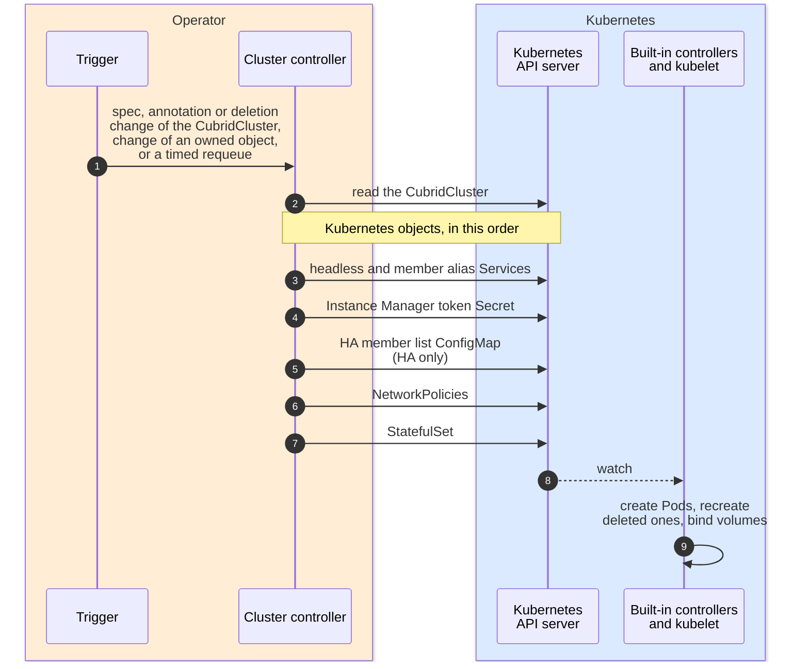
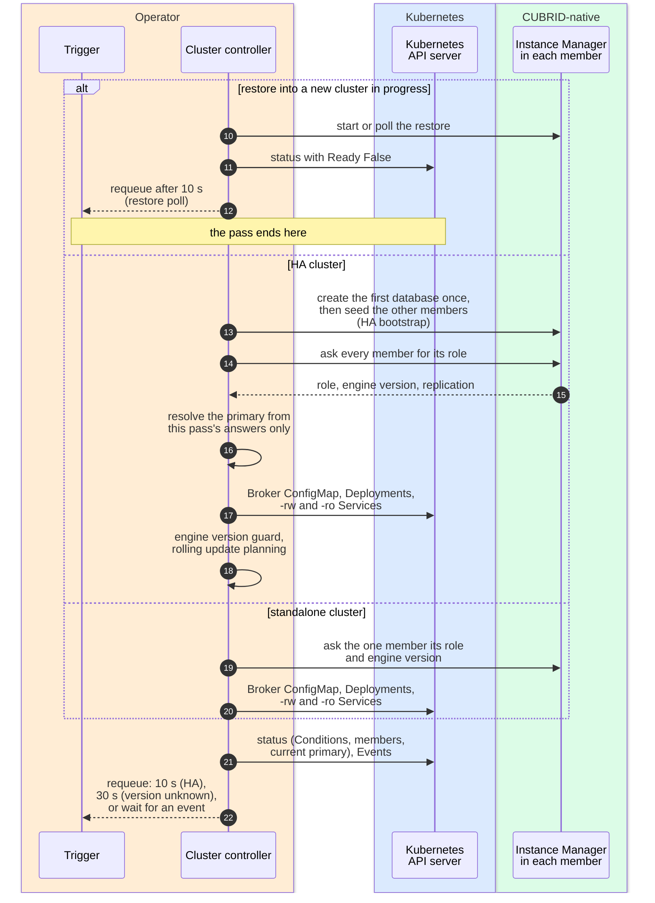
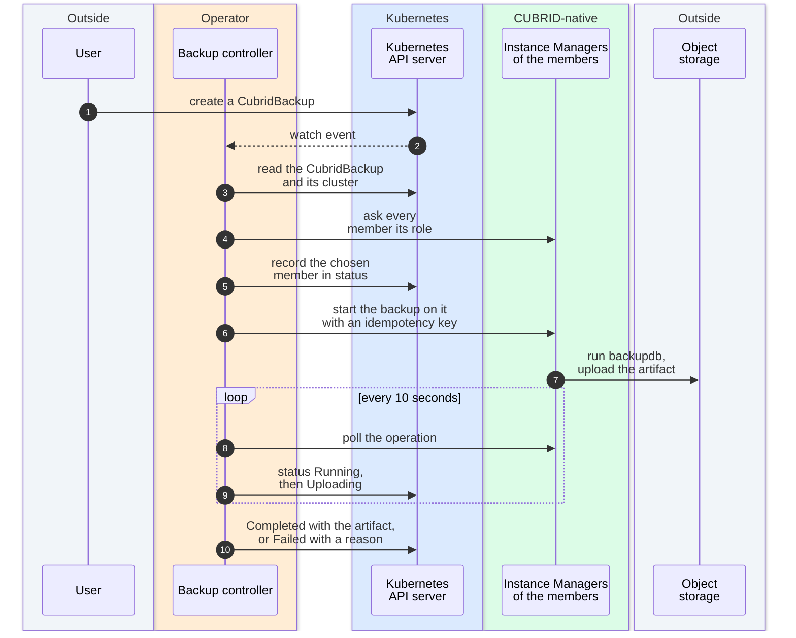

# Reconciliation

[Overview](README.md) → [Topology](topology.md) → **Reconciliation** →
[Client and data path](data-path.md) →
[Failure and recovery](failure-recovery.md)

> The project is experimental and not production-ready. Colors, line styles
> and evidence labels are explained in the [legend](README.md#legend).

## What it shows

One pass of the cluster controller for a `CubridCluster`: what starts it,
which Kubernetes objects it writes and in what order, what it asks each
member's Instance Manager, how it turns those answers into status and
Conditions, and when it runs again. The controller compares the desired state
(the spec) with what it observes in Kubernetes and in the members, and acts
through two channels only: the Kubernetes API and the Instance Manager. It
never starts a Pod itself and never runs SQL. A second, smaller diagram shows
the backup controller.

## Cluster controller

The pass is drawn in two parts; participants that appear in both keep the
same names, and the numbering continues. The first part shows the Kubernetes
objects, the second the observation of the members, the status write and the
next pass. The background of each group of participants uses the
[legend](README.md#legend) colors.

### Part 1: trigger and Kubernetes objects

### Part 2: observe, report and run again

### Key components

- **Trigger** — the controller's work queue. Items come from watches and
  from the delay a previous pass asked for.
- **Cluster controller** — `CubridClusterReconciler`. The DESIGN.md §7 roles
  (cluster, HA, service, storage, update) are steps of this one controller;
  see [Two controllers and the six named roles](README.md#two-controllers-and-the-six-named-roles-in-designmd).
- **Kubernetes API server** and **built-in controllers** — the Operator
  writes objects; the StatefulSet and Deployment controllers and the kubelet
  create, start and restart the Pods.
- **Instance Manager** — answers the role question and runs the HA
  bootstrap, backup and restore operations inside each member.

### Reading order

1. **Steps 1–2:** a trigger arrives and the controller reads the current
   `CubridCluster`. A deleted cluster ends the pass; its objects are removed
   by Kubernetes garbage collection through owner references.
2. **Steps 3–7:** the Kubernetes objects are written in a fixed order, so
   that member DNS names, the token and the NetworkPolicies exist before the
   first database Pod. A failure at any step ends the pass with a `Ready=False`
   Condition naming the step.
3. **Steps 8–9:** Kubernetes, not the Operator, turns the StatefulSet into
   running Pods with their volumes.
4. **Steps 10 onward (part 2):** the controller observes and acts according
   to the cluster's state. For an HA cluster, the primary is resolved only from the
   answers of this pass: exactly one master among freshly observed members, or
   no resolved primary. The Broker tier is reconciled after that, and the
   rolling update only when the engine version guard allows it.
5. **Last steps:** the status is written once, with the Conditions, the
   member list and `currentPrimary`, and Events are emitted for changes. The
   pass then returns a requeue delay or none. A restore in progress is the
   exception: that branch writes its status and returns the 10-second restore
   poll at once, so these last steps do not run for it.

### When the controller runs again

The controller is driven by events, with timed requeues on specific paths.
It is not a fixed one-second poll.

| Situation | Next pass | Why | Source |
|---|---|---|---|
| Spec, annotation or deletion change of a `CubridCluster` | immediately | the `clusterEvents` filter passes these; status-only changes do not start a pass, because the controller writes the status itself | `clusterEvents` in [`cubridcluster_controller.go`](../../internal/controller/cubridcluster_controller.go) |
| Change of an owned StatefulSet, Deployment, Service, ConfigMap, Secret or NetworkPolicy | immediately | `Owns(...)` watches | `CubridClusterReconciler.SetupWithManager` in `cubridcluster_controller.go` |
| HA cluster with role discovery configured, after a successful status write | 10 seconds | a CUBRID failover changes no Kubernetes object, so no event would report the new roles | the end of `updateStatus` in `cubridcluster_controller.go`; `haResyncInterval` in [`haresolve.go`](../../internal/controller/haresolve.go) |
| Restore into a new cluster in progress | 10 seconds | poll the restore operation | `restorePollAfter` in [`bootstrap.go`](../../internal/controller/bootstrap.go) |
| Standalone cluster whose engine version is not known yet | 30 seconds | otherwise an idle cluster would stay blocked until an unrelated event | `standaloneVersionPending` and `standaloneVersionRetryInterval` in [`update.go`](../../internal/controller/update.go), used by `updateStatus` |
| Token Secret not yet in the cache; a short-lived write conflict; a status write conflict | 1 second | retry a transient condition without reporting it | `errIMTokenSecretNotCached` in `Reconcile`, `lastingConflict` in `failed`, and the conflict check after `writeStatus` in `updateStatus`, all in `cubridcluster_controller.go` |
| Any other write failure | controller-runtime's rate-limited backoff | the error is returned; the failure is reported once as a Condition and an Event | `failed` in `cubridcluster_controller.go` |
| Standalone cluster, nothing pending; or a cluster name that cannot be used | no timed requeue | the next event starts the next pass; an unusable name is a terminal error and is not retried | the end of `updateStatus`, and `refuseClusterName`, in `cubridcluster_controller.go` |

A role answer older than 15 seconds is treated as unknown
(`roleObservationTTL` in `haresolve.go`), so a slow pass cannot resolve
a primary from stale answers.

## Backup controller

### Reading order

1. A `CubridBackup` is created. The backup controller watches only
   `CubridBackup` objects.
2. It reads the cluster, asks every member for its role and picks a member
   that is safe to back up. The choice is written to status **before** the
   backup is started, so a lost response never leads to a second backup on
   another member.
3. The start request carries an idempotency key built from the backup's
   namespace, name and UID, so a repeated request finds the same operation.
4. The controller polls the operation every 10 seconds until it ends, then
   writes `Completed` or `Failed`. A finished backup is not processed again.

### Evidence

| Statement | Level | Where |
|---|---|---|
| The backup controller watches only `CubridBackup` | Implemented | `CubridBackupReconciler.SetupWithManager` in [`cubridbackup_controller.go`](../../internal/controller/cubridbackup_controller.go) |
| Target recorded before the start; one idempotency key per backup | Implemented, Design | `startBackup` and `idempotencyKey` in `cubridbackup_controller.go`; target choice in `selectBackupTarget`, [`backuptarget.go`](../../internal/controller/backuptarget.go); [ADR-0007](../adr/0007-backup-execution.md) |
| Poll every 10 seconds; finished backups are skipped | Implemented | `backupPollAfter` and the `BackupPhaseCompleted`/`BackupPhaseFailed` check at the start of `CubridBackupReconciler.Reconcile`, `cubridbackup_controller.go` |
| A real `CubridBackup` on an HA cluster completes and its artifact is verified independently | Observed (VM lab) | [ROADMAP.md](../../ROADMAP.md#implementation-and-validation-inventory), row "Backup and restore": no Kind e2e test creates a `CubridBackup`; the backup and restore scenarios ran on the VM lab |

## How the controllers reach the Instance Manager

- **Address:** `http://<member>.<namespace>.svc:9090/v1/...`, through the
  member's alias Service
  (`HTTPBackupClient.baseURL` in
  [`imclient.go`](../../internal/controller/imclient.go), and the role URL in
  [`roleprober.go`](../../internal/controller/roleprober.go)).
- **Authentication:** a bearer token read from the cluster's
  `<cluster>-im-token` Secret (`ClusterTokens` in `imclient.go`; the
  `Authorization` header is set in `acceptedTokens.send`). Only `/livez` and `/readyz`, which the kubelet probes, are
  unauthenticated
  (`Server.Handler` in
  [`server.go`](../../internal/instancemanager/server.go)).
- **Endpoints the controllers call:** `GET /v1/role` (role, engine version,
  replication), `POST /v1/ha/bootstrap`, `POST /v1/backup`,
  `POST /v1/restore/prepare`, `GET /v1/operations/{id}` and
  `GET /v1/operations?idempotencyKey=`.
- **Endpoints served but not called by the controllers:** `GET /v1/ha/status`
  and `GET /v1/ha/convergence` (diagnostics and tests), and
  `POST /v1/shutdown`, which the member's own preStop hook calls through
  `instance-manager shutdown`
  (`RequestShutdown` in
  [`operations.go`](../../internal/instancemanager/operations.go);
  `preStopShutdown` in `cubridcluster_controller.go`).

## Evidence

| Statement | Level | Where |
|---|---|---|
| Order of the Kubernetes writes | Implemented | `CubridClusterReconciler.Reconcile` in `cubridcluster_controller.go` |
| Recovery first, then the HA or standalone branch, then one status write | Implemented | `updateStatus` in `cubridcluster_controller.go` |
| Primary resolved only from the current pass's fresh answers | Implemented, Design | `reconcileHAStatus` and `resolvePrimary` in `haresolve.go`; [ADR-0005](../adr/0005-failover-split-brain.md) section 3 |
| Pod readiness follows `/readyz` only; `HAReady` is a separate Condition | Implemented, Design | the `ReadinessProbe` in `podSpec`, `cubridcluster_controller.go`; [docs/observability.md — Health model](../observability.md#health-model) |
| The Conditions and what each reason means | Implemented | [docs/observability.md — Conditions](../observability.md#conditions) |
| Rolling update planning exists, but automatic Pod replacement is switched off | Implemented | `reconcileRollingUpdate` and its `AutomaticReplacement` check in `update.go`; ROADMAP.md row "Hardening" |
| An HA cluster bootstraps, replicates and reports one primary on the real image | Observed (Kind in CI) | ROADMAP.md row "HA and Broker" |

## Limits and assumptions

- The diagram leaves out the token rotation steps, the conflict-retry
  details and the per-step failure Conditions; the functions named above have
  them.
- While a restore into a new cluster is in progress, role observation and the
  Broker tier are skipped and the cluster is reported not ready
  ([ADR-0008](../adr/0008-restore-semantics.md)).
- The Conditions describe what the Operator observed, not whether a client can
  run SQL; see "Client ready" in
  [docs/observability.md](../observability.md#health-model).
