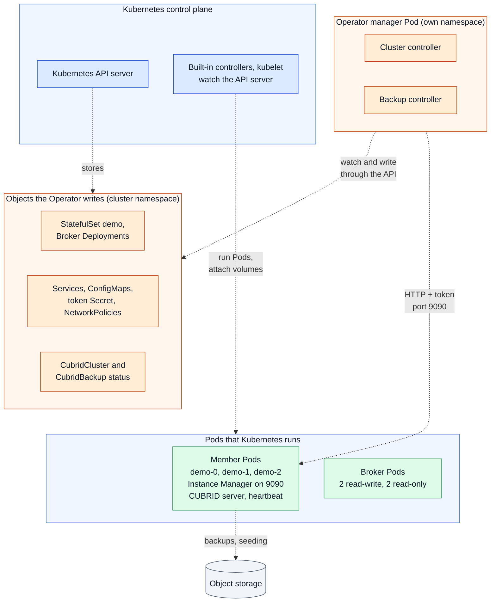
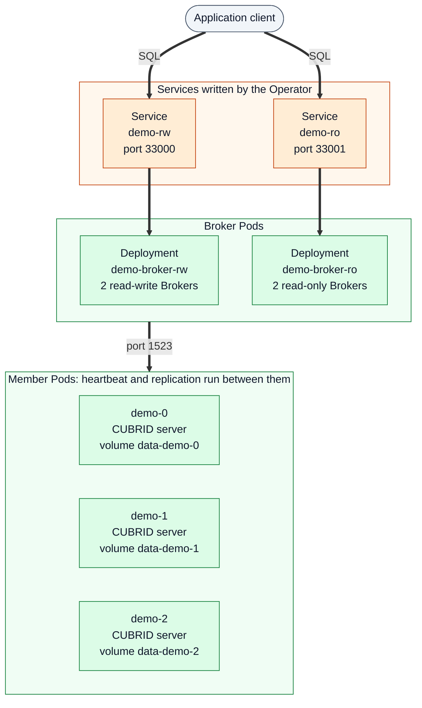

# System topology

[Overview](README.md) → **Topology** → [Reconciliation](reconciliation.md) →
[Client and data path](data-path.md) →
[Failure and recovery](failure-recovery.md)

> The project is experimental and not production-ready. Colors, line styles
> and evidence labels are explained in the [legend](README.md#legend).

## What it shows

This is the base picture that the other pages build on: where the Operator
runs, which Kubernetes objects it creates for one `CubridCluster`, and how
those objects relate to the database members and the Brokers. It shows a
three-member HA cluster named `demo`. A standalone cluster is the same with
one member and no HA member list (see [Standalone and HA](#standalone-and-ha)).
The Operator runs in its own Pod and is never one of the database Pods.

The picture is drawn as two diagrams that use the same names: the control
path (who writes and runs what) and the data path (where SQL and replication
go).

### Control path

### Data path

## Key components

All names are those of the [shared component table](README.md#shared-components).

- **Operator manager Pod** — one controller-runtime manager hosting the
  cluster controller and the backup controller, with leader election, a
  metrics endpoint and health probes.
- **StatefulSet `demo`** — the database members. Each Pod has one database
  container in which the Instance Manager is the main process and supervises
  the CUBRID server and, for HA, heartbeat. An HA member with NetworkPolicies
  enabled also has a short init container that waits until a peer's server
  port answers ([README — Network access](../../README.md#network-access)).
  Each member keeps its own volume.
- **Member DNS** — the headless Service `demo-instances` and one alias
  Service per member give every member a stable name that survives a Pod
  restart. CUBRID's HA member list and the Operator's Instance Manager calls
  use these names.
- **Broker tier** — two Deployments, one per access mode, separate from the
  database Pods. The Services `demo-rw` and `demo-ro` select Broker Pods,
  never database Pods.
- **Configuration objects** — the HA member list (`cubrid_ha.conf`), the
  Broker configuration and `databases.txt`, the per-cluster Instance Manager
  token, and the ingress NetworkPolicies.

## Reading order

1. In the **control path** diagram, start at the **Operator manager Pod**.
   Its two controllers only talk to the **Kubernetes API server** and, over
   HTTP, to the **Instance Manager** in each member.
2. Follow the dotted arrows from the API server: the Operator writes the
   StatefulSet, Deployments, Services, ConfigMaps, Secret and NetworkPolicies;
   the **built-in controllers and kubelet** turn them into running Pods.
3. Look at a **member Pod**: the Instance Manager and the CUBRID processes
   share one container, and each member has its own volume. The controllers'
   HTTP calls on port 9090 go to the Instance Manager, never to the CUBRID
   server.
4. In the **data path** diagram, follow the thick arrows from the
   **application client**: SQL goes to a Service, a Broker and a CUBRID
   server. The Operator is not on that path.
5. Between the members, **CUBRID heartbeat and replication** run directly,
   without the Operator, as the member group's label says. The
   [data path](data-path.md) page draws them.

## Standalone and HA

| | Standalone | Three-member HA |
|---|---|---|
| `spec.highAvailability.enabled` | `false` | `true` |
| `spec.topology.promotableMembers` | must be 1 | must be 3 |
| Members | `demo-0` | `demo-0`, `demo-1`, `demo-2`; CUBRID decides at run time which is master |
| HA member list ConfigMap | none | rendered by the Operator from the member names |
| Brokers and `-rw`/`-ro` | yes; both point at the one server, and `-ro` is read-only access to it, not a replica | yes; read-write Brokers seek the master, read-only Brokers serve reads |
| Instance Manager polling by the Operator | `/v1/role` of the one member on each reconcile, for its engine version and readiness; no periodic resync, except a retry every 30 seconds while the engine version is unknown | `/v1/role` of every member on each reconcile, and another reconcile 10 seconds after each one that writes its status |

Validation rules for the member count are in
[ADR-0001](../adr/0001-ha-topology.md) ("Validation (v1alpha1)").

## Evidence

| Statement | Level | Where |
|---|---|---|
| One manager process runs both controllers with leader election, metrics and health probes | Implemented | [`cmd/main.go`](../../cmd/main.go): the `ctrl.NewManager` options, the two `SetupWithManager` calls, and `AddHealthzCheck` and `AddReadyzCheck`; the `--leader-elect` flag in [`config/manager/manager.yaml`](../../config/manager/manager.yaml) |
| The cluster controller owns StatefulSets, Deployments, Services, ConfigMaps, Secrets and NetworkPolicies | Implemented | `CubridClusterReconciler.SetupWithManager` in [`cubridcluster_controller.go`](../../internal/controller/cubridcluster_controller.go) |
| One database container per member; Instance Manager supervises CUBRID in it | Implemented, Design | `podSpec` in `cubridcluster_controller.go`; [ADR-0003](../adr/0003-instance-manager.md) "Decision"; [DESIGN.md §9](../../DESIGN.md#9-instance-manager) |
| StatefulSet uses the `demo-instances` Service, parallel Pod start and `OnDelete` updates | Implemented | `ServiceName`, `PodManagementPolicy` and `UpdateStrategy` set in `reconcileStatefulSet`, `cubridcluster_controller.go` |
| Member alias Services give each member its short HA name | Implemented, Design | `reconcileMemberServices` in [`memberservice.go`](../../internal/controller/memberservice.go); [ADR-0004](../adr/0004-ha-hostname-dns.md) |
| Two read-write and two read-only Broker Pods in separate Deployments behind `-rw`/`-ro` | Implemented, Design | `brokerReplicas` and `reconcileBrokerTier` in [`broker.go`](../../internal/controller/broker.go); [ADR-0002](../adr/0002-broker-routing.md) |
| Ports: Broker 33000/33001, server 1523, Instance Manager 9090, heartbeat 59901/UDP | Implemented | `brokerRWPort` and `brokerROPort` in [`broker_config.go`](../../internal/controller/broker_config.go); `cubridServerPort` and `instanceManagerPort` in `cubridcluster_controller.go`; `haHeartbeatPort` in [`memberservice.go`](../../internal/controller/memberservice.go) |
| A standalone cluster and a three-member HA cluster become Ready on the real image | Observed (Kind in CI) | [ROADMAP.md](../../ROADMAP.md#implementation-and-validation-inventory), rows "Foundation" and "HA and Broker" |
| Three-member HA with an installed Operator on the VM lab | Observed (VM lab, recorded runs) | ROADMAP.md, the installed HA run paragraph; [docs/testing/installed-ha.md](../testing/installed-ha.md) |

## Limits and assumptions

- The diagram shows one cluster in one namespace. The manager can watch all
  namespaces or one (`--watch-namespace`, see
  [README — Manager watch namespace](../../README.md#manager-watch-namespace)).
- Non-promotable read replicas are not supported in `v1alpha1`
  (`readReplicas` must be 0).
- NetworkPolicies are drawn as one box. They only take effect with a network
  plugin that enforces them; see
  [README — Network access](../../README.md#network-access).
- Placement of the database members, PodDisruptionBudgets and multi-zone
  layouts are not shown because the Operator does not manage them yet
  (ROADMAP.md, "Hardening"). The Broker Deployments only carry a preferred
  anti-affinity on the node name (`brokerPodSpec` in `broker.go`).
